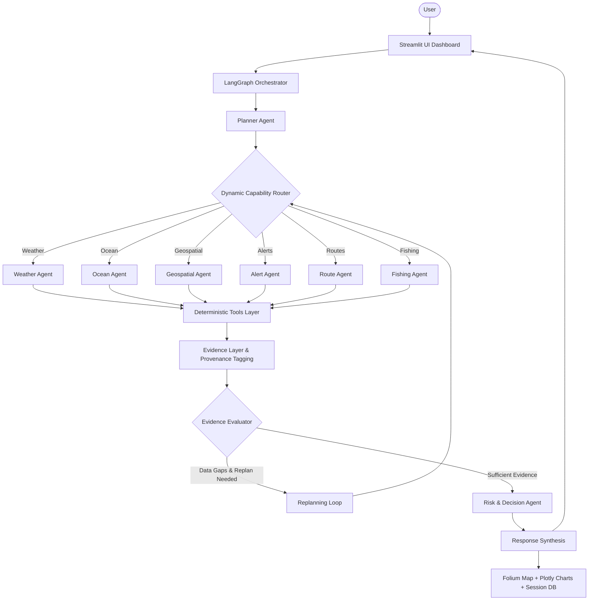

# ORCA
### Marine EcOsystem Reasoning with Collaborative Agents

ORCA is an agentic marine intelligence and decision-support platform designed for coastal regions, artisanal fishers, and maritime navigators. Built with LangGraph, specialized collaborative agents, and deterministic oceanographic tools, ORCA translates natural-language queries into multi-agent task workflows, analyzes metocean telemetry and marine protected areas, correlates multi-source evidence, evaluates risks against transparent safety thresholds, and dynamically replans when data gaps occur.

---

## Overview

Coastal fishermen and navigators frequently must assemble disparate, heterogeneous sources of information—atmospheric weather, ocean sea state, wave heights, marine protected boundaries, and weather advisories—to make safety-critical decisions. Existing systems either provide static charts or raw, overwhelming numeric tables without cross-domain synthesis.

ORCA serves as an intelligent reasoning partner. It interprets conversational maritime queries, orchestrates specialized agents, executes deterministic Python tools (ensuring no arithmetic or geospatial hallucination), verifies data provenance, and synthesizes understandable, evidence-backed dossiers with interactive maps and charts.

---

## Problem

Marine operations along coastal waters (such as the Konkan and West Coast of India) face acute challenges:
- **Fragmented Data:** Weather, sea state, tidal heights, and advisories are distributed across multiple distinct dashboards and portals (IMD, INCOIS, global NWP models).
- **Artisanal Safety Limits:** Small fishing craft have lower operational thresholds for wind gusts and wave chop than commercial shipping vessels, yet standard marine forecasts lack localized craft-specific hazard interpretations.
- **Geographic Regulatory Hazards:** Marine Protected Areas (MPAs), conservation zones, and naval firing corridors often lack accessible geofence verification for coastal fishers.
- **Hallucination Risk in AI:** Generic LLMs often fabricate numerical buoy data or navigational coordinates when prompted with maritime queries.

---

## Solution

ORCA resolves these challenges by decoupling natural-language understanding from deterministic calculations:

```
User Natural Language Query
          ↓
Planning & Task Decomposition (Planner Agent)
          ↓
Dynamic Capability Router
          ↓
Specialized Multi-Agent Execution (Weather, Ocean, Geo, Route, Alert, Fishing)
          ↓
Deterministic Marine Data & Tool Verification
          ↓
Evidence Layer & Provenance Tagging (LIVE, SAMPLE, HISTORICAL, UNAVAILABLE)
          ↓
Multi-Source Evidence Evaluator & Cross-Domain Correlator
          ↓
Multi-Parameter Risk Assessment & Threshold Audit
          ↓
Dynamic Replanning Loop (Injected fallbacks on missing/failing telemetry)
          ↓
Response Synthesis & Interactive UI (Streamlit, Folium Map, Plotly Charts)
```

---

## Architecture



---

## Agents

ORCA organizes reasoning across 9 collaborative specialist agents:

1. **Planner Agent:** Decomposes queries into structured subtasks, parses granular temporal scopes (`CURRENT`, `TODAY`, `TOMORROW`, `NEXT_N_HOURS`, `HISTORICAL`, `WHAT_IF`), detects targets, and maintains session continuity.
2. **Weather Agent:** Queries meteorological conditions (wind speed, wind gusts, atmospheric pressure, precipitation) using live Open-Meteo forecasts.
3. **Ocean Agent:** Ingests sea state metrics including significant wave height, swell period, sea surface temperature, and ocean currents.
4. **Geospatial Agent:** Resolves geographic coordinates, computes geodesic distances (Haversine), and performs point-in-polygon containment checks against Marine Protected Areas (MPAs).
5. **Fishing Specialist Agent:** Evaluates sea surface temperature gradients, chlorophyll suitability, and distance from shore to compute demonstration Potential Fishing Zone (PFZ) indices.
6. **Route Agent:** Plans candidate passages (Direct Inshore vs Recommended Safe Offshore), checks corridor clearance against exclusion zones, and scores route safety.
7. **Alert Agent:** Ingests, filters, and ranks coastal advisories, squall warnings, and marine bulletins by severity.
8. **Evidence Agent:** Cross-references telemetry across agents to audit consistency (e.g., verifying that squall warnings align with elevated wind speeds).
9. **Risk Reasoning Agent:** Evaluates accumulated evidence against deterministic, documented thresholds for small artisanal craft and evaluates what-if hypothetical conditions.

---

## Deterministic Tools

ORCA's agents invoke deterministic Python tools rather than allowing LLMs to perform arithmetic:

- `fetch_marine_weather`: Queries live Open-Meteo weather API for wind, gusts, and rain.
- `fetch_marine_conditions`: Queries live Open-Meteo marine API for wave heights, wave direction, and swell period.
- `lookup_coordinates`: Resolves coastal names to verified coordinates.
- `check_point_in_zones`: Vector polygon intersection (Shapely/GeoPandas) checking proximity to Marine Protected Areas.
- `plan_candidate_marine_routes`: Generates waypoint passages and checks geofence intersections.
- `compute_pfz_suitability`: Calculates multi-factor fishing suitability scores.
- `compare_coastal_locations`: Geodesic and metocean comparison between dual coastal locations.
- `fetch_marine_advisories`: Parses coastal marine safety advisories.
- `fetch_sst` / `fetch_chlorophyll` / `fetch_tide_data`: Environmental oceanographic fixtures.

---

## Data Sources & Provenance

Every data item presented in ORCA is stamped with its authentic provenance classification:

| Provenance Label | Data Sources | Description |
| :--- | :--- | :--- |
| **LIVE** | Open-Meteo Weather & Marine API | Real-time live forecasts for wind, gusts, precipitation, wave height, swell period, and direction. Free and unrestricted. |
| **SAMPLE** | Marine Protected Areas, Advisories, SST, Chlorophyll, Currents | Curated GeoJSON boundaries (e.g., Malvan Marine Sanctuary) and realistic oceanographic demonstration fixtures. |
| **HISTORICAL** | Climate averages & past observations | Baseline reference averages used for multi-day anomaly comparisons. |
| **MOCK / UNAVAILABLE** | Simulated sensors / fallback adapters | Graceful placeholders activated when upstream APIs return errors or when sensors are offline. |

> **IMPORTANT:** ORCA never disguises sample or mock fixtures as live data. All responses, charts, and tables display provenance badges (`[LIVE]`, `[SAMPLE]`, `[HISTORICAL]`, `[MOCK]`).

---

## Agentic Features

- **Dynamic Task Selection:** Simple queries (e.g., "What is the weather near Ratnagiri?") invoke only relevant agents (`weather`), avoiding unnecessary overhead.
- **Conditional Routing:** LangGraph dynamically routes through specialized agents based on user intent and accumulated state.
- **Observation Evaluation & Replanning:** If primary telemetry is missing or an API returns an error (e.g., 503 Service Unavailable), the `evaluator` triggers `replan_node` to inject fallback data collection tasks without crashing.
- **Multi-Turn Session Memory:** Persistent SQLite database retains context locations, previous intents, and conversation history across turns.
- **What-If Hypothetical Reasoning:** Deterministically simulates hypothetical metocean shifts (e.g., "What if wind speed increases to 30 km/h?") and evaluates impact on craft safety thresholds.
- **Audit Trace:** Complete execution trace logging node transitions, elapsed times, and status without exposing hidden LLM scratchpads.

---

## Route Reasoning Notice

> [!IMPORTANT]
> Route waypoints and passages generated by ORCA are **purely informational and illustrative**. They are **NOT certified navigation routes** and must **never** be used for primary vessel navigation or passage planning. Primary navigation requires official hydrographic charts, certified ECDIS, and local port authority clearance.

---

## Potential Fishing Zone (PFZ) Notice

> [!NOTE]
> Potential Fishing Zone (PFZ) suitability ratings in ORCA are generated by a **demonstration multi-factor model** combining SST and chlorophyll indicators. They are **NOT official government PFZ advisories**. Artisanal fishers in India should consult official bulletins published by INCOIS (Indian National Centre for Ocean Information Services).

---

## Installation & Setup

### Prerequisites
- Python 3.10 to 3.14
- Git

### 1. Clone the Repository
```bash
git clone https://github.com/<your-username>/ORCA-Marine-Agent.git
cd ORCA-Marine-Agent
```

### 2. Create Virtual Environment
```bash
python -m venv .venv
```

Activate the virtual environment:
- **Windows (Command Prompt / PowerShell):**
  ```powershell
  .venv\Scripts\activate
  ```
- **Linux / macOS:**
  ```bash
  source .venv/bin/activate
  ```

### 3. Install Dependencies
```bash
pip install -r requirements.txt
```

---

## Configuration

ORCA is designed to be **100% free to run out of the box** without requiring any paid API keys or cloud subscriptions.

Copy the example configuration:
```bash
cp .env.example .env
```

`.env` configuration options:
```env
# Optional LLM Provider Configuration
# Supported providers: deterministic, openai, anthropic, gemini, groq
LLM_PROVIDER=deterministic
LLM_MODEL=
LLM_API_KEY=

# Orchestration Settings
MAX_REPLANS=3
DATABASE_PATH=data/orca_sessions.db
API_TIMEOUT=10.0
```

> **Zero-Cost Operation:** If `LLM_API_KEY` is not provided, ORCA automatically runs using its built-in deterministic planning engine. All weather, marine, geospatial, and risk calculations run seamlessly without an LLM key.

---

## Running the Application

Launch the Streamlit interactive dashboard:

```bash
streamlit run app.py
```
Or with explicit virtual environment Python:
```bash
.venv\Scripts\python.exe -m streamlit run app.py
```

Open your browser at `http://localhost:8501`.

---

## Running the Automated Test Suite

ORCA includes 80 comprehensive tests covering unit tools, LangGraph workflows, replanning loops, and end-to-end user scenarios:

```bash
pytest -q
```
Or:
```bash
.venv\Scripts\python.exe -m pytest -q
```

---

## Example Queries to Try

| Category | Example Query |
| :--- | :--- |
| **Maritime Safety** | *"Is it safe to fish tomorrow near Ratnagiri?"* |
| **Coastal Comparison** | *"Compare Ratnagiri and Goa."* |
| **Fishing Suitability** | *"Find nearby favourable fishing zones."* |
| **Geospatial Geofencing** | *"Are there restricted zones near Ratnagiri?"* |
| **What-If Simulation** | *"What if wind speed increases to 30 km/h near Ratnagiri?"* |
| **Passage Planning** | *"Find an informational route from Ratnagiri to Goa."* |
| **Marine Warnings** | *"Are there marine warnings near Ratnagiri tomorrow?"* |
| **Multi-Turn Context** | Turn 1: *"How are conditions in Ratnagiri?"* → Turn 2: *"Is it safe to fish there tomorrow?"* |

---

## Limitations

To ensure total scientific integrity, the following limitations are transparently acknowledged:
1. **Prototype System:** ORCA is an academic and hackathon Agentic AI prototype, not a commercially deployed maritime vessel traffic management system.
2. **Non-Authoritative Advisories:** Marine advisories and weather warnings currently use sample curated fixtures modeled after IMD bulletins. They do not yet stream real-time push alerts from INCOIS or IMD RSS feeds.
3. **Coarse Bathymetry & Charts:** Navigational routes do not incorporate high-resolution electronic nautical charts (ENCs) or depth soundings; route waypoints avoid known sanctuary polygons but do not account for submerged sandbars or tidal shoals.
4. **Demonstration Ocean Chemistry:** Real-time satellite ocean chlorophyll and SST telemetry are represented via regional sample fixtures rather than direct live satellite downlink (such as Copernicus or MODIS).

---

## Future Work

- **Live INCOIS & IMD Feed Ingestion:** Integrate official government RSS and CAP-XML emergency alert feeds.
- **Live Satellite Oceanography:** Connect direct Copernicus Marine Service (CMEMS) API endpoints for real-time SST and chlorophyll-a rasters.
- **Multilingual Voice Interaction:** Voice input and output in coastal regional languages (Marathi, Konkani, Hindi, Tamil) for artisanal fishing communities.
- **Offline Edge Operation:** Packaging lightweight quantized models for onboard deployment on coastal vessels with limited cellular coverage.

---

## License

This project is licensed under the MIT License - see the LICENSE file for details.
